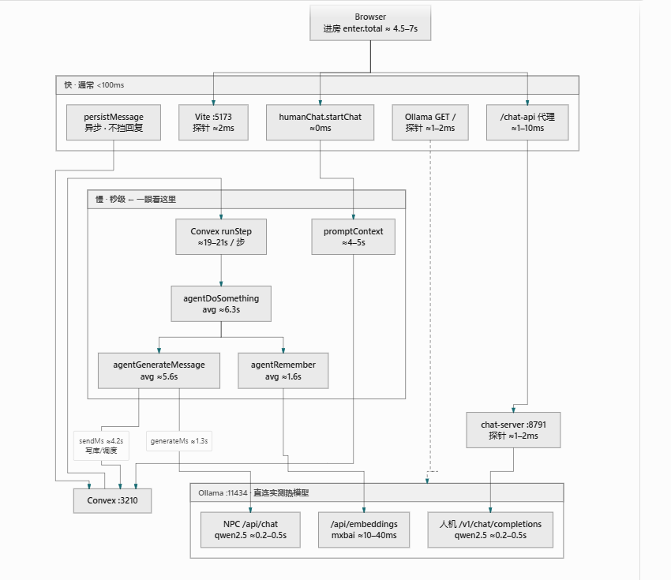
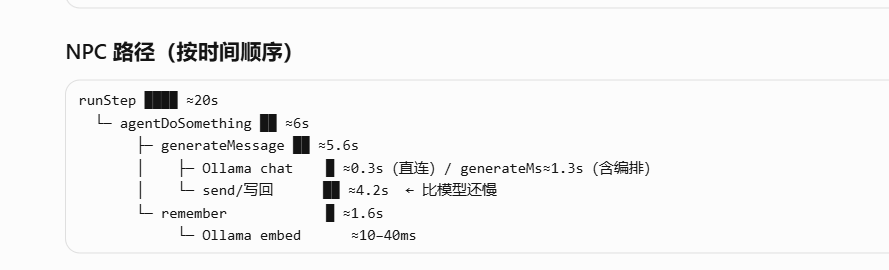

# 本机架构与耗时图

面向 Windows + Docker Convex + 本机 Ollama。数字来自本机监控与直连实测，会随负载变化。

相关：[ARCHITECTURE.md](./ARCHITECTURE.md) · [README.local.md](./README.local.md)

---

## 1. 运行时总览（含耗时）



---

## 2. NPC 路径（按时间顺序）



---

## 3. 人机路径（对照）

```
开聊:  UI ─0ms─► startChat ─██4–5s─► promptContext ─快─► 本地可聊
发消息: UI ─1–10ms─► chat-server ─█0.2–0.5s─► Ollama chat ─快─► 回显
                                              └─异步 persistMessage（不挡 UI）
```

---

## 4. 读图要点

| 标记 | 含义 |
|------|------|
| 探针 RTT | 只探活，不是推理 |
| generateMs | 拼 prompt + 调模型 |
| send/写回 | `runMutation(agentSendMessage)` 墙钟；业务很轻，慢在 mutation 排队 |
| runStep | 引擎一步；含 load / tick / saveWorld |

Ollama 热推理通常只有零点几秒；秒级多半在 Convex 步进与写回。

---

## 5. 端口速查

| 组件 | 端口 | 职责 |
|------|------|------|
| Vite | 5173 | UI、`/chat-api` 代理、监控页 |
| Convex | 3210 / 3211 | 世界引擎、NPC AI、持久化 |
| chat-server | 8791 | 人机 LLM、探针、指标 |
| Ollama | 11434 | `qwen2.5` + `mxbai-embed-large` |
| Dashboard | 6791 | Convex 管理台 |
